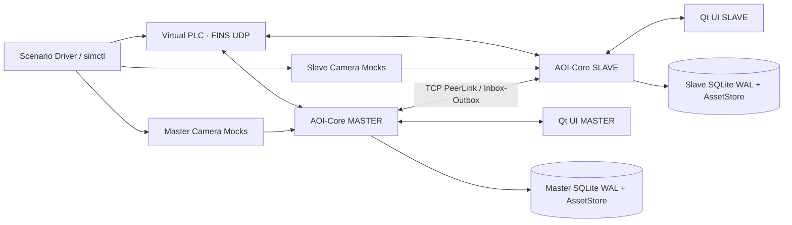

# AOI Vision Platform · 多 AI-Agent 全功能离线双机开发执行总计划（PLAN v1.1 · 第三轮独立复判修订版）

> **计划日期**：2026-10-15 ｜ **项目阶段**：待开发，计划已建立；并不代表计划项已经实现。  
> **唯一设计输入**：`/AOI开发项目` 中《新一代双机 AOI 上位机完整开发设计工作包 v2.0》，原始旧机工作包只读。  
> **只读工具资源**：`/工具开发`，优先复用 Qt/OpenCV/OpenVINO 的已验证 SDK、源码模板、测试资产。  
> **本次“完成全部计划”的验收解释**：先交付**能真实运行、能重复自动化验证、全部业务闭环的离线双机仿真软件**；实机 PLC/机器人/相机及真实产品算法精度另列 `HARDWARE` 现场阶段，不得冒充已验收。  
> **完整性**：130 项 WBS，其中 W001～W122 是离线软件与发布任务，W123～W130 是硬件/现场后续任务；原 v2.0 的 114 项需求、114 条验收用例、21 个模块和 14 条现场门禁均已建立机读关联。

## 1. 项目最终目标与“完成”定义

### 1.1 要实现的不是演示 PPT，而是真软件

最终离线交付有两个**真实且独立启动的 AOI-Core 进程**（Master 和 Slave）、两个 Qt Quick/QML UI 进程、一个独立虚拟 PLC（vPLC）进程。前后端使用进程间消息通讯，主从使用真实 TCP 通道传输可信封套消息，Core 与 vPLC 使用可验证的 FINS/UDP 读写报文；**只对隔离的虚拟 PLC 写寄存器**。相机驱动层是真接口+假的 SDK 实现，采图是带时间戳、FrameId、缓冲区所有权的虚拟硬触发回调；图像处理仍可用真正 OpenCV 5.0.0 做像素处理/线扫分路/ROI/结果图渲染。检测算法第一阶段采用**可复现的 MockInference**，并提供通用 OpenVINO ONNX/IR 烟测；不把假检测、通用道路识别结果称为电池缺陷精度。

需要把**模拟过程和正式生产架构用同一套领域模型及接口**连起来：同一源码，Master/Slave 不同角色；未来替换适配器而不是推倒重写调度、数据库、UI。所有在线硬件能力均通过接口注入，`SimOnly` 和未来的 `Field` 构建/运行权限彼此隔离。

### 1.2 两套验收层级（不可混淆）

| 层级 | 交付状态 | 本轮验证 | 禁止冒称 |
|---|---|---|---|
| **SIM_READY：离线全功能模拟交付** | W001～W122 完成且门禁通过 | 真实 Master/Slave、双 UI、独立 vPLC、模拟 9 采集设备、11 结果通道、状态机、数据库、方案/换型、诊断、授权、安全、故障注入，Linux 和实际 Windows PE/Wine 证据 | 现场相机驱动兼容、PLC 程序认可、工艺精度、机器人真实动作、Windows 原生验收 |
| **FIELD_ACCEPTED：现场正式验收** | SIM_READY 且 W123～W130、14 项 FG 真实证据和有权人员签字 | 真 SDK、硬触发与相机读回、当前 PLC 只读核对/受控站级验证、真实 NG 去向、标定、模型真值、生产节拍、Windows 原生和长时稳定 | 在只用模拟器时直接声称产线完成或自动解除现场阻断 |

**SIM_READY 不能以“写了代码/页面截图/单机假数据”代替**；必须是双机和 vPLC 五进程实时完整端到端执行、生成日志、数据、逐料图像和审计证据。SIM_READY 不要求拥有现场硬件，因此 14 项 FG 可保持未解除但必须**阻断真实写**，并在现场台账显式保留。

### 1.3 本轮用户要求的模拟范围

- **通讯模拟**：真实 TCP 主从、真实本机 IPC、vPLC FINS/UDP 报文；模拟网络抖动、丢包、断线、重发、重启、超时、乱序，验证消息落库和业务幂等。
- **相机 SDK 模拟**：7 台海康面阵、2 套 Itek 线扫设备，共 9 物理采集接口；调用 Configure/ReadBack/Arm/WaitFrame/Stop/Health；注入硬触发、帧率、曝光/增益读回、帧丢失和 SDK 错误。
- **采图与处理模拟**：可重复图片 fixture、真正的 RawFrame 所有权、按旧规则进行线扫拆路，OpenCV5 做预处理/ROI/渲染；质量分类及缺陷位置可由 MockProvider 决定，并显式标记 `SIMULATED`。
- **双机模拟**：Master/Slave 不共享进程内存、数据库或私有文件；真实双进程协议、主机统一最终质量、从机上传站点结果；支持停从机、网络断连、分区及重新连接。
- **产品与 UI 模拟**：完整可用的 11 图 4×3 主屏、可视化 PLC 地图与参数表双向联动、离线试跑、草稿/发布/一键安全换型、原图/结果图历史和故障排查，全部从 Core/DB 实际状态读取，不能用页面硬编码伪状态。

## 2. 安全边界与事实来源（任何 Agent 不能越过）

### 2.1 原始事实、新契约和现场未决分层

`LEGACY_STATIC` 是旧工程/PLC备份可见的静态事实，`PROPOSED` 是新设计，`INFERRED` 是有证据推论，`FIELD_REQUIRED` 必须现场读回才能定论。没有现场证据的值不得借口“已经被旧版写过”就作为可写生产真值。

高危位置包括：定位 D1030/32/34 与旧 PLC 消费 D1000/02/04 不一致；D1013 反面线扫/清料别名冲突；扫码 D2000 从 PLC 10 WORD/20 字节和旧 PC 读取 20 WORD/40 字节不一致；D2099 末端应答和真实码源未证；D1016=1/2 的实际出料分流未证；设备 UserSet/线扫硬触发方向与双光对应未读回。这些在演示 UI 中可标“旧证据/待核”，不可标“现场已确认”。

### 2.2 网络、写入、物理硬件隔离

1. `AOI_BUILD_SIM_ONLY=ON` 构建不编入任何生产 PLC/相机驱动载入或真实地址写入通道；虚拟 PLC 端点仅允许回环地址，例如 `127.0.0.1:19600`。模拟用户界面显示醒目的 `SIMULATION / 禁止接生产设备`。
2. Core 写 PLC 只能调用 `PLCGateway.WriteAuthorizedAsync()`，由后端 `WritePolicy` 做 AllowList/Actor/Release/Epoch/条件验证；UI IPC 不能传任意原始 D 地址执行写入。对虚拟 PLC 的写入不等于授权生产设备写入。
3. 模拟场景采用独立 vPLC 进程与环回网络；CI 具备权限时额外使用网络 namespace/容器禁止任意外网出口。若环境无法执行强隔离测试，则报告 `NOT_VERIFIED` 而不是宣称物理隔离已由防火墙证明。
4. 所有 14 项现场 `FG-xx` 在独立台账保持 `FIELD_PENDING`，模拟正常流程**不解除**生产风险门禁。实机版只有在具备现场证据、审批、地址白名单和维护安全状态时才讨论受控写。
5. `/AOI开发项目` 和 `/工具开发` 只读，不修改原 ZIP/SDK/旧 EXE/DLL/PLC 工程。新源码、编译、日志、SQLite、截图放独立工作树与输出目录。禁止执行旧软件或机械控制程序。
6. 任何 `MISSING/ERROR/IDENTITY_AMBIGUOUS/TIMEOUT/RELEASE_MISMATCH` 不能自动解释为 OK。安全配置缺失和数据可靠性不可证明时进入 HOLD/FAULT，需要可审计恢复。

### 2.3 资源与技术版本锁

- Qt **6.11.2** + C++20 + Qt Quick/QML（正式 AOI UI，不复用旧 Qt Widgets UI）；OpenCV **5.0.0 单版本**；AI 推理接口可用 OpenVINO **2025.4.1**（模拟算法不依赖真实电池模型）。
- 主目标 Windows 10/11 x64；Debian 13 开发测试；Qt Windows 编译器与 SDK 的 LLVM-MinGW **22.1.7** ABI 对齐；另外的 Clang23 工具链不可未经测试混链。
- 参考 `/工具开发/05_项目模板/VisionForge_Qt6_YOLO11_ONNX_已修复源码与QA.zip` 的 CMake、依赖打包、OpenVINO 真实 ONNX 测试经验；注意模板 Qt Widgets/C++17 并非 AOI Qt Quick/C++20 成品。优先复用项目工厂 `devkit.py` 但需迁移 UI 和目标语言标准。
- 模型包依实际格式带对应 ONNX/IR 前端、CPU plugin、TBB/VC++ 依赖。不能只检查 `openvino.dll` 存在；必须真实加载与推理。

## 3. 架构总图：仿真拓扑、部署职责及线程隔离

### 3.1 进程与消息拓扑（最小五进程）



相机 mock 通常作为对应 Core 的设备适配模块实例，`simctl` 负责场景脚本与触发注入，因此**不额外要求两个模拟相机进程**；如需要崩溃隔离，可把相机模拟独立进程升级为扩展配置。Master 和 Slave 的 DB、出入队列、资产根路径、日志、缓存、端口和角色文件必须独立；不以同一进程两个对象冒充双机。

### 3.2 建议进程命名与职责

| 进程 | 主要职责 | 网络/文件界限 |
|---|---|---|
| `aoi-core --role master --profile sim/master.json` | 主站采图与定位、扫码、主机工位/最终质量、方案主发布者、全局追溯聚合 | master.db、master/assets、独立 IPC 与 PeerLink 监听端口 |
| `aoi-core --role slave --profile sim/slave.json` | 从机采图、4 面阵+反线扫处理、工位判断、持久化 Outbox/原图、本机诊断 | slave.db、slave/assets、PeerLink 主动连接或受控监听 |
| `aoi-ui --host master --ipc ...` | 主机生产/工程/地图/统计/方案界面 | 只通过 Core IPC 访问数据和命令 |
| `aoi-ui --host slave --ipc ...` | 从机本机生产状态/工位配置/诊断界面，主机独占最终质量 | 不绕过 Core 修改从机 Release |
| `vplc --scenario ... --bind 127.0.0.1:19600` | 虚拟寄存器、FINS/UDP 读写、硬触发/扫码/末端/PLC时序状态机 | 只监听 localhost，审计模拟写入 |

### 3.3 三种独立的数据通道

- **业务命令/事件**：UI↔Core IPC（快照订阅+增量游标+有鉴权命令）；Core↔Core TCP 可靠消息（Outbox+Inbox 去重）；Core↔vPLC FINS/UDP（仅模拟）。
- **原图/结果图资产**：各机本地 SSD 文件仓库，数据库只存 AssetId、hash、父子链、相对 URI；跨机高清图通过独立受控资产请求/同步，不把 123 MB 大帧塞进普通 PeerLink Event。
- **预览画面**：独立低分辨率缓存与过时帧覆盖机制，Qt Scene Graph 用纹理进行缩放/平移。**预览队列可以丢旧帧，生产原图与最终状态事件不能悄悄丢**。

### 3.4 采集与质量三重“完成”

`FRAME_READY`＝SDK交付并安全持有帧，`CAM_HANDSHAKE_COMPLETE`＝按 PLC 站级协议采图应答完成，`PRODUCT_FINAL_RESULT`＝主机聚合有效最终结果。这三个状态必须由不同事件定义和测试，CamDone D1006～D1014=2 不等于 OK；D1016=1/2 是整料良品/不良；D2099=2 只表示末端扫码/上传分支完成，**不是良品**。

### 3.5 资源与性能基本纪律

相机 callback 不压缩图/写磁盘/推理/刷 QML；只校验帧和交接引用。核心队列 bounded、带 backpressure，线程工作单元可取消且有监视；队列满报错/停线策略显式。两套线扫的静态参考帧是 **8200×15000×8bit = 123,000,000 bytes**，一套设备只保存一份父原帧，按 `img[1::2]` 和 `img[2::2]` 分成 7500/7499 行；首行丢弃是**旧规则需保留并测试**，不可随意从第0行拆；主从镜像/旋转需跟旧契约一致且仍标“待现场光路核验”。

## 4. 首先冻结的公共契约（A0 主责，其他 Agent 只提变更申请）

### 4.1 标识、状态、最小消息

每一份会影响最终质量的记录至少保留 `WorkpieceId, Epoch, ReleaseId, ChannelId, CaptureId, AttemptNo`（对应任务需要另有 `StationId`, `PhysicalDeviceId`, `HostId`, `CaptureGroupId`, `FrameId`, `ResultId`, `EventId`, `TraceId`, `ModelHash`）。同一条码不必然同一个 WorkpieceId；不同 Epoch 的迟到图不能填补新件结果。协议带 `SchemaVersion`, `MessageId`, `PayloadHash`, `SequenceNo`, `OccurredUtc`, `MonotonicElapsed`, `CorrelationIds`。

严格区分 `ProcessingStatus={PENDING,RUNNING,SUCCEEDED,ERROR,CANCELLED,TIMEOUT}`、`QualityStatus={UNDECIDED,OK,NG,MISSING,SKIPPED_BY_VERIFIED_CONDITION}`，各站完成后保留“计算成功但判 NG”与“计算报错不可判定”两种互斥情况。Main final 必须基于 expected channel set + 完整扫码来源与有效 Release、Epoch。未核准的屏蔽不能被算作通过。

### 4.2 要在 S00 冻结的至少 12 个接口与约束

| 契约号 | 内容 | Owner | 必须提供的合同测试 |
|---|---|---|---|
| C-01 | 领域 Strong IDs / 枚举 / 事件 SchemaVersion | A0 | 同名不同类型 ID 禁止混用；旧版 schema 拒绝或明确迁移 |
| C-02 | `IAreaCapture`、`ILineCapture`、`FrameRef`、配置与 ReadBack | A3 | SDK缓冲复用、帧不完整、线扫组捕获唯一 |
| C-03 | `IPLCGateway`、`SignalRegistry`、`WritePolicy` | A2 | FINS WORD/BA/BADC golden vectors + 真实写禁用 |
| C-04 | `IWorkpieceTracker` / `IAcquisitionCoordinator` | A1 | 重拍/旧 Epoch/缺图/无槽位不串件 |
| C-05 | `IStationDecision`/`IAggregateDecision` | A1 | NG vs ERROR/缺图/采集完成与质量隔离 |
| C-06 | `IPeerLink` / Reliable Envelope / PERSISTED_ACK | A5 | ACK丢失重复重放不重复生效；同 ID 异 hash 报警 |
| C-07 | `IAssetStore` / metadata / 无损 codec | A6 | 写入崩溃恢复与压缩解码像素 hash 一致 |
| C-08 | DB SQL migration / Outbox-Inbox / Query | A6 | 两机独库、事务原子性、幂等统计 |
| C-09 | `IModelAndAlgorithm` / ROI TransformChain | A4 | 模型丢失、步骤失败、ROI外 NG 仍计入结果 |
| C-10 | ProductSolution / Draft / immutable Release / Deployment | A7 | 改草稿不影响 Active；两机哈希同版本才可激活 |
| C-11 | UIReadAPI / commands / snapshots / cursor | A8 | UI关闭与重启不中断Core；越权IPC不能修改配置 |
| C-12 | AuthAudit / AlarmEnvelope / Telemetry + EntityRegistry | A9 | ACK≠CLEAR；日志可跨模块追溯，不可伪造 Live 值 |

A0 所有者负责 `contracts/` + `libs/domain/` 单独冻结。每个契约至少提交 JSON Schema / C++20 头、版本演进规则、正例/反例、Mock接口、单测入口、所有权与超时约定、服务端错误码。**接口未冻结之前 Agent 只可创建独立接口桩，不得分别自创消息字段**。契约变更以 ADR 和影响矩阵走单个 PR，修改者不可自我审核通过。

### 4.3 一个业务事务的权威顺序

`WorkpieceCreated persisted → CaptureExpected(epoch/slot/attempt) → FrameReady + image ownership → CAM_HANDSHAKE_COMPLETE (按站门槛) → ChannelResult persisted → PeerOutbox persisted → slave result delivered/inbox persisted → master aggregate → FinalResult persisted → authorized vPLC D1016/D2099 branch → PLC observed/readback → Trace complete`。

注意这里是逻辑先决关系，现场硬触发的帧和 PLC 请求的**观测先后可能相反**；AcquisitionCoordinator 要根据场站可信事件关联，不能写成“收到 D=1 才软件软触发”或据简单 FIFO 猜电池。旧正常末端可能 D1016 先写、D2099 后写，失败时顺序相反；必须以批准的模拟分支用例测试并为 FIELD 保留核验。

## 5. 开发阶段、详细工作包与闸门

WBS 清单是 `WBS_TASKS_130.csv`，**先满足 DependsOn 再开工，ID 号只是索引而非强制顺序**。一个 Agent 只能认领 `Owner` 对应目录；上游契约通过后才能合并依赖代码。`StageGate` 通过必须由 A10 复测并由 A0 接受。下列阶段可**并行进行其不冲突子任务**，不是等前一阶段100%完成才允许所有下一阶段动工。

### S00｜证据/技术/安全/合同冻结（W001～W010）

工作：锁定 v2.0 证据 SHA256；读 114 需求/21 模块/45 PLC 信号/14 FG；明确 static vs proposed；锁 Qt ABI 和 SDK；冻结工程目录、公共 DTO、错误枚举、写策略、审查流程和测试状态编码。**输出**：`BASELINE_LOCK.json`, `CONTRACTS_v1`, `ADR`, Owner Matrix, RQ/WBS/TC 矩阵、模拟安全模型。**门禁 G00**：所有接口有唯一 Owner、PLC 禁写默认生效、数据项有来源，CI 能校验契约。

### S01｜骨架/进程/UI IPC/持久基础（W011～W022）

工作：CMake Presets+C++20 Qt Quick；同一 Core 两种启动 role；UI 为独立进程、掉 Core 时显示离线；SQLite WAL+schema_migrations；结构化事件，生产队列；`simctl` 启停与 CI。**输出**：空画面可连接两台 Core、独立 DB、真实 Qt 窗口及可运行单测。**门禁 G01**：两个 Core 和两个 Qt UI 真实启动/停止，vPLC 启动器允许先用空骨架（不声称 FINS 通讯通过）；Master 与 Slave 文件树不共享，Core 的 crash/restart 能留证；无真硬件路由。

### S02｜vPLC、相机/采集 SDK 仿真（W023～W034）

工作：vPLC FINS/UDP memory read/write、BYTE/WORD/BADC/BA golden vector、PLC 动作/扫码/出料模拟；SignalRegistry 冲突与读写规则；7 台面阵 + 2 套线扫 AdapterMock；FrameRef、buffer pool、触发注入、掉帧/残帧/重连、确定性场景 DSL。**输出**：`vplc` 实际 UDP 交互轨迹、9 设备 API mock、每个模拟设备配置/读回和异常样例、`simctl` 五进程启动。**门禁 G02**：可以用 `tcpdump`/程序报文追踪证实 UDP 交互；非本机端点拒绝；同 seed 产生排除UTC/PID/临时路径的规范化业务事件摘要，并使用确定性屏障确保事件因果顺序稳定。

### S03｜逐料、采集关联、主从可靠消息（W035～W047；定位保护 W048 和首个完整 E2E W049 位于 S04）

工作：Workpiece/Slot 账本、Epoch/Attempt、乱序/空料隔离、队列 deadline、StationDecision/FinalDecision；上/末端扫码身份；TCP PeerLink 强一致消息封套、durable outbox/inbox、重试与幂等、主从职责。**输出**：无真实图像算法时就能跑 **Mock-result 逐料状态机的协议合同测试**。**门禁 G03**：故意投递缺路/重拍/迟到/同条码两件/重复 ACK；不得误 OK、误合并和重复计数；主从恢复后可识别 PERSISTED 和 COMPLETED 的区别。

### S04｜像素处理、离线模拟算法、持久资产与双机 E2E（W048～W067，加 W049）

工作：OpenCV5 图像处理及线扫真尺寸分路、方向/ROI/坐标空间、MockInference、OpenVINO 通用模型烟测、定位链模拟与冲突拦截；AssetStore、SQLite结果表、无损压缩/校验/原子 rename、Outbox 同事务、查询/备份/磁盘满策略。**输出**：两件多站交错运行的真实 11 通道结果图（检测是 mock），每路结构化Overlay与结果位图、线扫父帧及两机数据库有完整关联、完整逐料业务事件和虚拟 PLC 结果。**门禁 G04**：必须等 W049 所依赖的 W058/W060/W061/W062/W063 全部有可复测证据后，才可从某件重建其 11 路及双线扫父帧、比较原图像素 hash，强制 kill -9 后修复 PENDING，缺图不自动 OK；123 MB 压力运行证据。

### S05｜真正的 Qt Quick 全功能生产/设备工程工作台（W068～W082）

工作：11 图 + 第 12 格汇总同屏；实时帧龄/主从/件号、全图放大和缺陷 bbox；同件完整图集、整机游戏地图、PLC全字段参数表（Actual/Legacy/Draft/Applied 分列）、双向热点、单工位方案入口、ROI 绘制、模型/相机/线扫参数、日志/报警/基础质量展示。**S05仅完成UI可交互骨架与已有Core事件的只读展示，报警根因聚合/完整统计/工位草稿保存分别在S06/S07接通，不能提前报全功能通过。** **输出**：真实运行 Qt GUI 的 2560×1440 /1920×1080 截图与交互回归，绝不可复用 HTML 图片冒充 Qt 成品。**门禁 G05**：主屏 11 路同显且相互独立刷新，45 条基线信号可搜索，另以人工扩展的 500 条模拟行验证搜索性能（不得当作真实 PLC 信号）；图形、表、现有事件深链正确；未接入的高级诊断/统计必须显示“尚未就绪”而非假数据；UI 关闭重开 Core 不停，DPI 100/125/150% 实测或标注不能验证的环境。

### S06｜完整产品方案、双机一键换型、安全报警（W083～W095）

工作：MachineProfile 与 ProductSolution 清晰分层；PatchStationDraft 乐观锁、完整方案离线校验/发布冻结与模型hash；双机 Staged→设备 ReadBack→虚拟 PLC 参数 ReadBack→PREPARED_BOTH→Commit+新 Epoch；vPLC D3010..20 两 WORD 浮点/读回；异常回滚真实模拟设备 ReadBack；Core RBAC/双人审批、报警树、审计、事件快照，前端方案发布页。**输出**：产品 A、B 完整隔离，一键换型成功和注入失败分支，报错时强制 HOLD。**门禁 G06**：还须完成 Qt 工位编辑真实调用 PatchStationDraft（经 RBAC 审计），报警根因聚合与 ACK/CLEAR 实际接线；从机断开不能激活，无法读回不能恢复旧生产，UI 写 PLC 及越权 IPC 均被拒绝；恢复旧版必须证明双方设备参数/Release/Epoch 一致。

### S07｜离线实验室、统计报表和完整追溯（W096～W104）

工作：离线实验进程/数据仓库/网络隔离，单图/批图/完整11图三种重放，方案旧新 A/B 结果比较，MODEL/OFFLINE Mock 界限；日周良率/缺陷实例/首次结果、人工复判追踪、导出完整电池证据包、按报警/实体联动查询，建立 114 用例执行驱动。**输出**：历史单件/模型/配置/原图/结果图/末端事件一键可追；各报表有计算 SQL 和 sample oracle。**门禁 G07**：质量图表必须在 W100 统计口径生效后重新逐项验证，不能沿用S05早期页面截图；离线试跑不污染生产 DB、统计和 PLC；无真值时不得生成“电池检测准确率”数字；重复件的良率不翻倍。

### S08｜多层故障注入、系统可靠性与全量需求回归（W105～W114）

工作：按原 `06_实施与验收/65` 的异常注入基线扩展到关键分支；杀主从 Core、ACK丢包、线扫坏帧、界面崩溃、PLC错编码/阻断写、旧 Epoch、双机发布半成功、低磁盘、SQL损坏/备份回滚；运行 114 项实际测试映射和界面截图验证。**输出**：每个 RQ/TC 的测试动作、命令、输入hash、退出码、日志、截图、环境、结果 `SIM_PASS/SIM_FAIL/SIM_BLOCKED/NOT_RUN`，任何真实硬件相关项标 `FIELD_PENDING`。**门禁 G08**：所有 SIM 范围 P0/P1 都有实际可重复结果，无 Critical/High 未关闭漏洞；失败视为阻断，不能只写文档完成。

### S09｜双平台打包、预验收、双轮软件审核与正式 SIM_READY（W115～W122）

工作：Linux GUI+Core 真实运行；Windows x64 PE 独立编译；核验 Qt平台插件、QtQuick/QML模块与imports、OpenCV5、OpenVINO前端/CPU 插件/运行时完整，先保存源码+Windows Release ZIP 与校验；**之后**才启动有限时的 Wine Windows EXE 五进程测试；保留用户 Windows 10/11 原生运行手册，未获取证据一律 `NOT_VERIFIED`。对成品代码/QA 做两轮审核与修复复跑，最后 SIM_READY 签收。**门禁 G09**：从干净 ZIP 实际运行所需进程，源码可构建，依赖哈希/许可证/测试证据齐全；不允许 Wine 环境问题阻碍已成功构建的源代码和发布包先行保存，但 Wine 失败不得计做 PASS。

### HARDWARE｜现场后续，不包含在本轮模拟完成声明（W123～W130）

实装海康/Itek 真设备适配、当前 PLC 只读证据、单站审批写测、模型/标定真值、节拍/硬盘压力/真实 Windows、14 门禁、分步切换与试生产。**未经用户取得现场权限并签核，不执行这些步骤，也不要求模拟阶段强行关闭它们**。

## 6. 多 Agent 人员分工与文件归属

### 6.1 11 个逻辑职位（推荐 Agent ID 固定，不因合并人数重编号）

| Agent | 责任域 | 独占修改路径（详见 AGENT_OWNERS.json） | 出口审核 |
|---|---|---|---|
| A0 架构总控 | 合同/DTO、ADR、合并与放行、安全边界裁定 | `libs/domain/**`, `contracts/**`, `docs/adr/**`, `tests/unit/domain/**` | A10 复审其自身代码 |
| A1 逐料调度 | Workpiece/Epoch/采图关联、质量判定与调度 | `libs/runtime/**`, `apps/aoi-core/**` | A10，A0 签合集成 |
| A2 PLC/vPLC | FINS、45 信号、协议编解码、vPLC时序与写入守卫 | `libs/plc/**`, `simulators/vplc/**` | A10 安全/负测 |
| A3 采集模拟 | 7 海康+2 Itek Mock、共享大图 buffer、线扫处理与标定 | `libs/device/**`, `libs/processing/**`, `libs/calibration/**` | A10 / A4 像素合同 |
| A4 算法/Replay | OpenCV流水线、MockInference/OpenVINO smoke、ROI和离线 Lab | `libs/models/**`, `libs/vision/**`, `libs/replay/**` | A10 测试与模型边界 |
| A5 双机通讯 | PeerLink、Envelope、可靠 ACK、断线恢复、去重 | `libs/peer/**` | A10 网络混沌测 |
| A6 数据/统计 | WAL、原始资产、索引、查询、恢复、报表 | `libs/data/**`, `libs/assets/**`, `libs/statistics/**`, `db/migrations/**` | A10 断电/一致性测 |
| A7 方案发布 | ProductSolution/Draft/Release、双机 Prepare/Commit/ReadBack | `libs/solutions/**`, `libs/deployment/**` | A10 / A2 发布安全 |
| A8 Qt UI | Qt Quick 11 图、可视 PLC、参数表、工程配置、全工作区 | `apps/aoi-ui/**`, `libs/ui_api/**`, `resources/qml/**` | A10 真 GUI 验证 |
| A9 诊断安全 | Core 鉴权、审计、报警与故障排查 | `libs/auth/**`, `libs/diagnostics/**`, `libs/logging/**` | A10 安全矩阵 |
| A10 独立 QA/Release | CI、模拟器编排、集成/混沌、测试证据、打包与发布 | `tests/integration/**`, `tests/chaos/**`, `tools/**`, `ci/**`, `packaging/**`, 根CMake、`scenarios/**`, `config/sim/**` | A0 审核测试可信性 |

### 6.2 几个 Agent 如何部署（不必真的同时开 11 个）

**理想：A0～A10 共 11 个逻辑 Agent**，阶段中各自独立分支。**资源有限：建议至少 6 个实际 Agent**；把角色合并但保留 ID 和文件所有权：① A0+A7；② A1+A5；③ A2+A3；④ A4+A6；⑤ A8+A9；⑥ A10（必须保持独立 QA）。若只有 4～5 个实际 Agent，优先保持 A10 不写被测业务代码、安排 A0 独立合并复核；会牺牲并行度，应按依赖串行推进，不能把“写完自己的模块”视为 SIM_READY。

**A10 工作量大于普通 Agent**（含 30 个任务），允许其他 Agent 补充其模块下的 unit/contract test、截图脚本，但它对最终 E2E 证据、失败判定与发布 Gate 保留独立审核权。一个 Agent 不能自己修改生产代码并单独签收该代码的生产正确性。

### 6.3 每个 Agent 每个 PR 必须上报

`AgentId / TaskId / RequirementIds / TestCaseIds / 变更路径 / 合同版本 / 代码commit / 运行命令 / 退出码 / 测试日志+SHA256 / 截图或PCAP路径 / 性能数据 / 未验证项 / 回滚方式 / Reviewer`。提交前不得把 WBS 状态从 `IN_PROGRESS` 直接改成 `SIM_PASS`；只有 A10 收到真实证据、A0 审核通过后可合并。Agent 不得把“按计划写好了”替换为测试记录。

## 7. 关键业务接口的实现规则和模拟场景

### 7.1 PLC / FINS 与条码

实现 FINS/UDP 所需的 Memory Read/Write 子集（只针对本设计使用的 DM WORD）、节点/端口/SID/响应码/长度校验；模拟 D1006～D1014、D1015、D1016、D1999、D2000、D2099、D2100、D3010..20、D1020..25 等**已列出**信号。vPLC 保存单次事务的原始 WORD 与 decode view。`float32 BADC` 必须使用测试矢量验证**有效载荷两 WORD**，不能依赖保存 UI 的虚拟长度；条码 BA/NUL/CR 原样保留；D2000 20/40 字节冲突在表格标红并提供负面测试，**不能默默补零等同现场真值**。

PLC 模拟分支覆盖：扫码成功/失败/重复、物料空槽、先硬触发后轮询请求、先请求后帧、线扫双路同一次 ACK、定位模拟写前映射 BLOCKED、下料扫码正常 D1016 再 D2099，以及扫码失败/错位先 D2099=3/4 再 D1016=2；任何分支的“写入成功”不能自动认为 PLC 已消费。

### 7.2 相机与线扫

HikMock 每台独立设备 SN/服务ID，`ConfigureTarget -> ReadBackActual -> Arm -> HardwareTriggerInjected -> FrameReady`；可模拟曝光、gain、PixelFormat、FrameId、断连、参数不被设备接受。ItekMock 每套设备由单一 `LineCaptureGroup` 管理共享的采集宽度/行数/帧/PLC ACK，生成 CH08/CH09 或 CH10/CH11 两路算法。主正线扫 split1 旋转 180、split2 不转；从反线扫拆分前水平镜像，两路各旋转 180（静态旧证据，待现场核）。提供**小尺寸快速样例**与 **8200×15000 真尺寸压力样例**，区分日常 CI 与高内存测试；不得把 100×100 玩具图的结果冒充 123 MB 压缩性能。

### 7.3 图像/算法与 ROI

`SensorROI` 会影响设备实际采集参数（模拟读回；未来停机）；`DetectionROI` 属于算法、改变质量；`DisplayROI` 只影响结果图卡视野，不改变质量；全部有 coordinate space 与 TransformChain 哈希。MockInference 的检测框、置信度、类别、错误码由 fixture manifest 真实读入，可从结果图和 DB 再现；OpenCV5 实际完成像素处理、拆分、缩放/overlay。对模型不存在/shape不对/label不匹配/timeout，产生 `ERROR`，不写 Good。离线 A/B 不能把 Mock 的值当真实模型精度。

### 7.4 主从消息、持久一致性与故障恢复

本地事务同时提交业务状态和发送 Outbox；Receiver 持久化 InboxDedup 再回复 `PERSISTED_ACK`；`APPLIED` 和 `COMPLETED` 是另一级业务语义；物理通信允许重复传递但业务应用幂等。断网、发送进程崩溃、ACK丢失、磁盘损坏、重复消息（同ID同hash/不同hash）必须分别给出可观察状态。Slave 只提交本侧 ChannelResult，**不写 D1016 最终结果**；Master 对同 `WorkpieceId+Epoch+Release+ChannelId+Attempt` 聚合。主从不能靠互相共享同一个 WAL 文件实现“同步”。

### 7.5 生产数据与质量统计

图像资产至少 `PENDING_WRITE→AVAILABLE/FAILED/CORRUPT/ARCHIVED`；原图像素与格式、原帧 hash、结果图和结构化 overlay、每路图像的父资产/变换链、每张图的 WorkpieceId/ReleaseId 全部关联。原图无损压缩与 DB 索引不同资源，必须可在断电后对账并恢复；真实外部 SSD/存储容量未确认时报告不确定性。日报/周报**按最终有效工件计数**，重拍同件不加产量，缺陷实例数与NG件数分开，ID0空料和ID1良品不计缺陷，离线试跑不参与生产指标。

### 7.6 产品配方/双机换型

Product A、B 配方互不共享可变阈值；单站保存更新 A 的 `SolutionDraft(revision)`，不改 Active Release，不污染 B，线扫共用硬件参数变动时两路提示。发布：`VALIDATED→RELEASED→STAGED→PREPARED_BOTH→COMMITTING→ACTIVE`，需要不可变快照与全部模型/标定/配置hash，两机模拟硬件 ReadBack、vPLC尺寸 float32 两 WORD 读回、无在制件/安全排空的模拟信号；失败 `FAILED_SAFE/HOLD`，不能仅修改 DB 版本号就宣称回滚完成。

### 7.7 报警、权限、交互数据统一来源

地图节点/连线、PLC表、站点配置与日志共同引用 `EntityRegistry/SignalId`；同一个 D1013 的冲突不允许地图显示安全、表格显示可写。日志封套统一 `trace_id,workpiece_id,station_id,signal_id,host_id,epoch,release_id,source,actual_status`。报警描述要求“位置、现象、影响、可能根因、排查顺序、恢复条件”，ACK 与 CLEAR 两态独立；用户角色由 Core/RBAC 真校验，前端禁用按钮不是安全边界。操作员/品质/视觉工程师/设备工程师/管理员互不越权，危险发布需要双审并保留审计 ID。

## 8. 多层测试与证据策略（A10 独立把关）

### 8.1 测试金字塔（每一层有执行产物）

| 层级 | 样例 | 必须输出 |
|---|---|---|
| `unit` | 强类型 IDs、状态机、字节序、ROI矩阵、生产统计与权限策略 | CTest/单测日志+退出码+覆盖受测范围 |
| `contract` | MockHik/MockItek/PLCGateway/IPeerLink/DataRepository/Schema | mock + real boundary 双向合同、golden input/output bytes |
| `integration` | 双Core+vPLC+两个SQLite+PeerLink，不启GUI | 完整事件追踪、出入队列和数据库快照/校验 |
| `gui` | Qt真实应用点击结果卡、地图、编辑草稿、离线试跑 | 2560/1920多DPI真实Qt运行截图+互动日志 |
| `chaos` | 延迟/重复/ACK丢/进程重启/坏帧/磁盘满/回滚中断 | 故障 seed + 注入时点 + 期望断言 + 真实输出 |
| `perf/memory` | 123MB线扫、并发件、AssetStore写压、UI缩放 | 平均、P50/P95/P99、峰值内存、frame drops与非现场SLO免责声明 |
| `release` | Linux重现、Windows x64 PE依赖闭包、Wine实际EXE运行 | hash manifest、DLL/插件报告、启动/关闭日志和必要截图 |
| `field` | 真实PLC/机器人/相机与工艺真值 | `FIELD_PENDING`，本轮模拟不生成假证据 |

### 8.2 强制覆盖的异常/安全负测（最低）

1. 两件同条码不同 `WorkpieceId`；2. 主/从结果交错；3. 从机断联60秒+重连；4. Peer ACK丢失、重复业务消息；5. 不同 payload 同 MessageId；6. 旧 Epoch 迟到帧；7. 单站重拍 AttemptNo 增加；8. 线扫两路中一路缺图/报错；9. 摄像机 FrameId 复用/缓存被覆盖；10. 相机断线后旧帧到达；11. PLC D1013 双用途冲突；12. 定位 D1030/D1000 任何真实写禁止；13. D2000 10/20WORD错字长/字符 NUL；14. BADC浮点写入正例/负例；15. 扫码错位/末端失败写顺序；16. D1016=2不得统计成良品；17. 发布阶段一台已Prepared、另一台失联；18. 回滚设备读回不符；19. 崩溃后 Asset `PENDING`/文件丢失；20. WAL 备份/恢复；21. 磁盘满/压缩写失败；22. UI死循环/崩溃但Core继续；23. 未登录 IPC 直发高风险命令；24. ROI 外 NG+显示裁剪；25. 新旧产品共享模型但不同阈值；26. 离线试跑不写生产DB/PLC；27. 真实非loopback远端模拟写请求被拒；28. 多次统计重算不翻倍；29. 缺算法模型/label不能OK；30. vPLC模拟读写返回与实际真实设备完成语义区分。

具体场景责任和验收断言见 `SCENARIO_MATRIX.csv`。每个重点故障场景需“注入→期望事件→机器可判断言→数据SQL/图片hash证据→截图/日志”，不能只有人工主观描述。

### 8.3 每条 RQ / TC 如何落到 WBS 和真实证据

`RQ_114_COVERAGE.csv` 每条包含 `RequirementId, SpecFile, Owner, PrimaryWBS, TestCaseIds, ExecutionState`。原 114 测试定义存于 v2.0 `acceptance_cases.csv`，不要擅自改原始编号。执行系统在 `evidence/runs/<run-id>/<TC-ID>/` 输出 `environment.json, inputs.json, steps.json, assertions.json, stdout.log, artifacts.sha256`。模拟阶段状态只有 `NOT_RUN/SIM_PASS/SIM_FAIL/SIM_BLOCKED`，不适用子断言必须有审批豁免原因，不能凭NA跳过P0；实体现场状态单列 `FIELD_PENDING/FIELD_PASS/FIELD_FAIL`，不得用 `SIM_PASS` 改写成实测 PASS。

### 8.4 SIM_READY 硬门槛与数据真实度

- 114 条需求均有 Owner/WBS/测试定位；本轮全部**适用于模拟的**条目具有可重复实际执行证据和明确断言；若存在无法在模拟验证的子断言必须显式 `FIELD_PENDING`，不可写伪造 PASS。
- P0 安全/身份/最终质量/主从/持久性/方案回滚/PLC禁写相关负测**全部通过**；存在 Critical/High 未关闭缺陷即不签 SIM_READY。P1 不得被默默推迟，可设置经 A0 解释的环境限制及下一步证据要求。
- 双机测试必须确认五进程确实启动，并证明 Master/Slave DB 不同 inode/目录、退出/重启独立、通信是 socket 而非全局变量；场景可重复 seed，证据文件 hash 可复算。
- UI 截图必须来自真正运行的 Qt 应用，线扫真尺寸压测不可使用缩小图代替；综合性能阈值以测试机 baseline 及现场后续目标区分，不提供虚构厂内节拍数字。
- 证据可以失败，但**发布状态不可把 FAIL 隐藏**。Windows 原生最终使用者/现场验收缺少可复算证据时标 `NOT_VERIFIED`。

## 9. 任务粒度、风险与决策登记

- 所有改造任务以 `Wxxx` 为原子开发卡，建议一次 PR 只解决 1～3 个同一 Owner 的相邻任务；一个 PR 产生新的公共 Schema 必须由 A0 通知涉及的 Agent，并在 merge 之前运行兼容测试。
- 没有测量数据不能替用户定义工艺准确率、P99节拍、SSD保留天数、复拍上限、产线停机恢复策略，先放 MachineProfile 配置及 `UNKNOWN/UNVERIFIED` 占位，现场 FG 依次核。
- 前端视觉实现必须可测试：模拟 11 个通道结果图各有独立更新时间；第12格整料质量只对应指定工件，不用11张最近图错误推断整料。
- 大图像内存风险：线扫每帧 123MB，主从各一套；按有界池上限、引用归还、pipeline 限流、内存性能门禁设计，避免一条 fixture 反复完整复制四次；OOM/磁盘满触发安全 HOLD。
- 软件质量风险：可靠消息不等于 exactly-once 网络，双机换型也不等于跨机数据库 ACID；采用幂等、readback、可审计失败补偿与不自动复产。
- 依赖风险：云端 SDK 是**只读分卷文件**，不是所有构建机已安装；每次构建需验证来源 SHA256、还原链及 Qt/Clang ABI，不可新会话默认缓存仍在。
- 开发人员不可为了让模拟 E2E 通过而放宽缺图、权限、地址冲突或 SourceEvidence 校验。这些是项目不变量而非可协商实现细节。

## 10. Git / Agent 并行协作与接口变更流程

### 10.1 分支管理与共享入口

一个正式仓库、唯一 `main`、只读 `reference/v2.0`、每个 Agent 独立 worktree/分支 `agent/Axx/Wnnn-topic`。通过 PR 合并，禁直接推 main。通用文件 `contracts/**, libs/domain/**, CMake 根, db/migrations/**, package lock` 有明确唯一 Owner；跨模块改动优先定义新 DTO+adapter，不允许同时多人修改同一头文件造成漂移。

建议仓库目录（所有路径是**规划中的新源码树**，不是云端库已存在的工程）：

```text
AOI-Vision-Platform/
  CMakeLists.txt, CMakePresets.json, README.md
  config/                   # 锁版本；MachineProfile/SIM profiles 分离
  contracts/                # A0 公共schema、事件、IPC、Peer、错误码
  libs/domain/              # 强类型IDs与共同不变量
  libs/runtime/             # A1 逐料与调度/最终质量
  libs/plc/                 # A2 FINS编码/网关/WritePolicy
  libs/device/, processing/, calibration/  # A3 相机、线扫、标定
  libs/models/, vision/, replay/           # A4 模型/算法/离线Lab
  libs/peer/                # A5 PeerLink可靠消息
  libs/data/, assets/, statistics/         # A6 DB/存图/质量
  libs/solutions/, deployment/            # A7 产品方案与换型
  libs/ui_api/              # A8 Core读API/Qt IPC bridge
  libs/auth/, diagnostics/, logging/       # A9 审计权限报警
  apps/aoi-core/            # A1同一二进制MASTER/SLAVE组装；A0仅审核公共契约，主/从同一二进制
  apps/aoi-ui/              # A8 Qt Quick/QML
  simulators/vplc/, simulators/cameras/, scenarios/
  db/migrations/            # A6 schema revisions，不覆写旧文件
  tests/unit/, contract/, integration/, chaos/, gui/
  tools/simctl/, tools/qa/, packaging/, ci/
  cmake/, scenarios/, config/sim/    # A10归属；SIM环境和触发编排
  docs/adr/, docs/release/, evidence/  # evidence默认不入源码提交
```

### 10.2 PR 合并与代码冻结门槛

1. Agent 先从根 `PLAN.md`、自己的 `AGENT_PROMPTS/Axx_*.md` 和 Owner/WBS/RQ/TC 表领取 `READY`（依赖完成）的任务；在工单登记自己写的文件和关联字段。
2. A0 先合并接口 v1 正反合同测试，再允许具体 Agent 创建 adapter。每个 PR 只修改自己独占路径；跨界需 Contract Change Request（版本差异、依赖列表、兼容方案、回滚）。
3. 提交 PR 时附可运行命令、退出码、测试证据 hash、示例生成截图；A10 在干净工作区独立复测关键路径；A0 检查对设计文档与安全边界的符合性。
4. 契约变更采用 `additive` 优先且 `schema_version` 显式；不兼容变更需联合升级双方编解码、DB migrations、模拟 fixture 和 UI。冻结后**不可悄悄修改 CSV、字段含义、PLC可写地址**。
5. 新功能的任务状态流转：`NOT_STARTED → READY → IN_PROGRESS → IMPLEMENTED → TESTED → REVIEWED → MERGED → VERIFIED_SIM`。失败 `BLOCKED/FAILED` 不会自动回到 `VERIFIED_SIM`；由 A10 重跑证据显式关闭。
6. 持久化的数据与上线包可追溯 `commit_id, build_id, spec_baseline_sha256, sdk_manifest_sha256, schema_version, release_id, run_id`。完成每个 G 生成 gate manifest 并保存 SHA256。
7. Release 阶段必须先保存 Source ZIP，再保存 Windows Release ZIP 和 checksum，最后对 Wine 做有限时验证；若 Wine 环境错误，保留已成功交付资产并将 Wine 状态标 `NOT_VERIFIED/FAIL`。

## 11. 集成节奏与可演示里程碑

建议按 G00～G09 **门禁驱动**迭代，不虚构具体开发工期，Agent 数量不足时按 DAG 串行。各阶段可随时合并已测可用增量，但一次只冻结可验证的 demo。目标演示如下：

| 演示点 | 必须能由用户看到/验证 | 切勿用来代替 |
|---|---|---|
| Demo-0 | 两个 Core + 两个 Qt UI + vPLC 分别可启停，状态真实响应 | 通讯和业务闭环 |
| Demo-1 | 7+2 虚拟设备产生模拟硬触发/读回，PLC真实 UDP 响应 | 真实硬件 SDK 成功 |
| Demo-2 | 主从交错处理两件相同/不同码的电池，缺图进入 HOLD，主机输出模拟 D1016/D2099 | 算法真实识别率 |
| Demo-3 | 11 个结果图真正来自处理管线，线扫父资产唯一，DB可追溯 | 现场线扫标定与硬件吞吐 |
| Demo-4 | 2K/1080p Qt 11图、设备地图+PLC表、报警联动、单站ROI | HTML 单页交互样稿 |
| Demo-5 | 产品 A→B 双机换型，设备 mock readback、审批、失败补偿停线 | PLC现场联锁签收 |
| Demo-6 | 历史单件11图+离线A/B试跑、报表、WAL/磁盘故障恢复 | 真实电池真值精度 |
| Demo-7 | 全部可模拟需求的自动测试与签名证据、Win x64 ZIP+源代码 ZIP、Wine实际运行证明 | 用户 Windows 原生及现场验收 |

## 12. 输出文件格式、计划使用与签收权限

本计划包交付 `PLAN.md`、`WBS_TASKS_130.csv`、`RQ_114_COVERAGE.csv`、`MODULE_21_OWNERS.csv`、`FIELD_GATES_14.csv`、`SCENARIO_MATRIX.csv`、`EXIT_GATES.csv`、`AGENT_OWNERS.json`、11份 `AGENT_PROMPTS/` 加 11份 `AGENT_TASK_CARDS/`、接口与模拟运行约定、两轮审核报告、审计脚本、哈希清单。各 Agent 只需读取同一个计划包并按 `TaskId/Owner/DependsOn` 工作；A0 负责对外集成和进度汇总。

验收权责：A0 对方案一致与集成负责，A10 对测试结果/证据独立负责，其他 A1～A9 对各自领域实现负责；用户/工艺/PLC/设备/品质负责人对现场风险和生产导入最终签字，AI-Agent 没有代签权限。**本计划文件的两轮审核只代表计划的交叉检查，不代表未来代码或实机测试已完成。**


## 13. v1.1 复判后的补充实施约束（多Agent必须遵守）

### 13.1 首个端到端验收的真实前置条件

`W049` 不能仅依赖五进程外壳、Mock算法和AssetStore框架就被认为完成：`W058` 实际结果图及可重建overlay、`W060` 线扫父帧和双路索引、`W061` 两机结果入库、`W062` 业务状态与Outbox同事务、`W063` 可查ReadModel以及`W051` 像素分路都必须先完成。验收时必须用数据库SQL、结果位图hash、父子资产关联、网络轨迹和独立进程证明，而不是用模拟页面/预写JSON代替。

### 13.2 S05/S06/S07 真实功能逐步交接

S05 的报警/质量/工位配置页面首先应消费真实Core查询，尚无后端功能时展示“未接入/未就绪”，绝不伪造实时数据或假通过。S06 将报警Lifecycle、根因聚合、RBAC和`PatchStationDraft`真实接入Qt；S07 将W100/W101工件级日周良率和缺陷统计接入Qt并复测。每个页面必须按 `UI_STAGE_INTEGRATION_MATRIX.csv` 的 `FinalRequiredPhase` 完成验证，不能因为S05有截图就提早签收RQs。

### 13.3 模拟身份来源与物理接口差异

仿真工件关联可以使用虚拟PLC额外提供的可控 `SimSlotOccupancy/SimStationTriggerSequence/SimCycleEpoch`，并将其来源标成 `SIM_ONLY_SYNTHETIC`；**绝不可据此断言现役PLC已经存在这三个字段**。如果缺少足够身份关联证据，Core进入`IDENTITY_AMBIGUOUS/HOLD`，不能以FIFO序号、条码相同或时间最近代替证据。

### 13.4 任何未授权修改命令必须默认拒绝

`W016` 阶段尚未实现 `W089` 后端RBAC，因而所有新增/未知的修改命令默认拒绝，只允许已经明确许可的只读快照与订阅。完成 W089/W090 后才按角色、操作、Release、Epoch、安全互锁逐项解锁，回归需覆盖“绕过Qt直接发送IPC”。SIM_ONLY也必须做到默认禁止非回环地址、生产DLL/相机驱动不可载入，无法证明操作系统级阻断时不得标实机网络隔离通过。

### 13.5 双机换型的准备含义

`W086` 只能达到 `STAGED/PREPARING_DEVICES` 并积累主从设备读回，不得把自己命名为最终 `PREPARED_BOTH`。`W088` 的主从PLC产品尺寸浮点读回成功以后，`W087` 才允许从 `PREPARED_BOTH` 走向 `COMMITTING`；任何一侧设备/PLC不一致、丢联、误Epoch均拒绝Ready。

### 13.6 Windows Qt Quick专项发布门禁

复用的 VisionForge 模板是 Widgets 示例，并**不能**证明 Windows Qt Quick/QML 发布闭包齐全；W007/W011必须首先清点 Qt Quick/QML/QuickControls2 模块并编译最小QML程序，W117须通过干净解压运行两套UI，检测 `qml` import 插件与 Qt6Quick/Qt6Qml/Qt6QuickControls2、平台qwindows.dll及OpenVINO前端。Wine测试只证明该Wine环境，不能替代Windows原生。

### 13.7 证据等级与准入

两轮既有PLAN审核多数是结构规则和字段存在性检查，不能据此推断行为正确。独立复判新增针对**任务真实前置闭包、场景截止阶段、代码所有权、关键业务阶段关系、SDK/基线哈希、字段状态闭包**的程序检查。每次修改WBS后必须重建依赖波次与任务卡，再运行三套检查与`sha256sum -c`。旧版本审核报告仅是历史记录。

---

**第一个严格可执行的 Ready 任务是 A0 的 `W001`**。其 BaselineLock 验证完成后，A0 的 `W002/W003`、A10 的 `W005/W007` 才解除依赖；随后 A2 的 `W006`、A9 的 `W008`、A10 的 `W009`、A0 的 `W004/W010` 按各自 DependsOn 解锁。完整的 37 层 DAG 就绪波次见 `DEPENDENCY_WAVES_37.csv`，不得把“已派发”当“依赖已满足”。过 `G00` 再进入 S01/S02 的并行实现；不建议先抢着做漂亮 QML 主界面而让业务协议和逐料 ID 后补。
